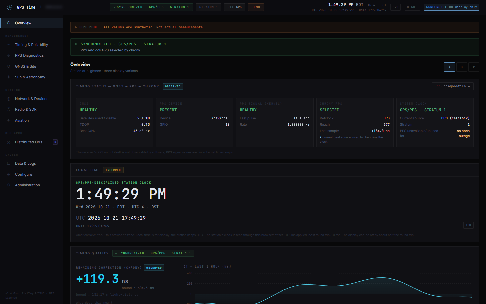

# GPS Time

GPS Time turns a Raspberry Pi and a GNSS receiver with a PPS output into a Stratum-1 NTP server for your network, running offline. It shows how good its time is, and why: every stage from satellite to NTP client is either observed or marked UNKNOWN.



*The Overview page in the desktop demo (synthetic data), taken in screenshot mode with location privacy set to rounded.*

**Status: v1.4.0-rc.11, pre-release.** It is soak-tested on one development Pi before v1.4.0. Open issues: [`docs/STATUS.md`](docs/STATUS.md).

## Quick start

**Demo on a PC** (no Pi, receiver or Internet needed; sample data). Needs Python 3.11+ and Node 22 with corepack:

```bash
cd web && corepack pnpm install --frozen-lockfile && corepack pnpm run build && cd ..
./scripts/run-demo.sh                          # http://127.0.0.1:8080/ (writes only under .dev/)
```

On Windows: `powershell -ExecutionPolicy Bypass -File .\scripts\run-demo.ps1` ([details](docs/development/windows-demo.md)).

**Install on a Pi** (Raspberry Pi OS Lite, Debian 12):

1. Generate the wiring snippets for your board: `python3 tools/generate_config.py --profile uputronics` (other profiles: [`docs/HARDWARE-PROFILES.md`](docs/HARDWARE-PROFILES.md)).
2. Follow [`docs/deploy/fresh-pi-install.md`](docs/deploy/fresh-pi-install.md): serial and PPS setup, chrony, the deploy script, the checks.
3. Open `http://<your-pi>/`.

Upgrading a 1.4 station: [`docs/deploy/upgrade-1.4-station.md`](docs/deploy/upgrade-1.4-station.md). The station serves plain HTTP: use it on a trusted LAN, or put a TLS reverse proxy in front.

## Supported hardware

| | Hardware | Known limits |
|---|---|---|
| **Tested** | Raspberry Pi 4 + Uputronics GPS/RTC board (u-blox MAX-M8Q, PPS on GPIO 18), Debian 12 | One development unit. Its antenna and site give a weak signal (best C/N₀ about 25 dB-Hz), which shows up as PPS outages. |
| **Expected to work** | Adafruit Ultimate GPS HAT, SparkFun GNSS Flex pHAT, Waveshare L76X (only after soldering PPS to GPIO 4) | Profiles exist; not run by the project. |
| | USB GNSS receivers (`usb-gps` profile) | NMEA only, no kernel PPS: millisecond-level time, not microsecond. |
| | Raspberry Pi 5; Debian 13 | Untested on hardware (Debian 13 runs in CI). |

Antenna placement matters as much as the receiver. Wiring and profile details: [`docs/HARDWARE-PROFILES.md`](docs/HARDWARE-PROFILES.md).

## Planned hardware

- **Dual-band u-blox ZED-F9T / ZED-F9P:** fewer outages, more satellites, raw data for PPP. Next on the list: [`docs/hardware/zed-f9-dual-band.md`](docs/hardware/zed-f9-dual-band.md).
- **SDR nodes** timed by a station: [`docs/roadmap/ROADMAP-SDR-RF-OBSERVATORY.md`](docs/roadmap/ROADMAP-SDR-RF-OBSERVATORY.md), [`docs/specs/SPEC-RF-NODE-AND-TDOA.md`](docs/specs/SPEC-RF-NODE-AND-TDOA.md).
- **Sensors** on timed nodes (seismic, infrasound, VLF lightning, muons, all-sky camera): [`docs/roadmap/ROADMAP-SENSOR-FUSION.md`](docs/roadmap/ROADMAP-SENSOR-FUSION.md).
- Reference parts list for all tiers: [`docs/hardware/HARDWARE-REFERENCE-NODE.md`](docs/hardware/HARDWARE-REFERENCE-NODE.md).

## Features

**Now:**

- **Serves time:** gpsd and chrony with the PPS refclock; honest fallback states (network, holdover, unsynchronized). The web UI never drives the clock.
- **Shows the timing chain:** receiver → satellites → PPS → chrony, with outages recorded as events and evidence kept on the SD card. It never names a cause the evidence can't establish.
- **Measures itself:** Allan, modified Allan and time deviation; chrony's error bound; comparison with independent NTP servers; an oscillator-versus-temperature log; time scales and leap-second expiry.
- **Knows its sky, offline:** sun and moon times, a sky map, the Earth's shadow and satellite illumination.
- **Respects privacy:** location exact, rounded or hidden everywhere; a screenshot mode for sharing.
- **One web UI** served by the station: no CDN, no external fonts, no analytics. Admin actions need a token; the service runs unprivileged.

Every value is labeled observed, calculated, modeled, predicted, inferred or external.

**Planned:** PPS history views, NTS and PTP, a trained oscillator model for holdover, a desktop app for laptops in the field, SDR and sensor nodes, and a coordinator for networks of stations. Phases and status: [`docs/ROADMAP.md`](docs/ROADMAP.md).

## Accuracy

Measured on the tested development unit (Pi 4, MAX-M8Q, weak antenna site), from the station's own readings. Details: [`docs/development/raspberry-pi-deploy.md`](docs/development/raspberry-pi-deploy.md).

| Measurement | Result | When |
|---|---|---|
| chrony's RMS offset from the PPS reference | 244 ns | after a 14-day run (rc.8, 2026-10-19) |
| PPS interval, kernel timestamps, 600 pulses | 1.000 000 s ± 1.3 µs | rc.10, 2026-10-19 |
| Allan deviation (includes outages) | 1.7 × 10⁻⁶ at 1 s; 2.2 × 10⁻⁸ at 100 s | 14-day run |
| Holdover: one 56-minute loss of PPS | clock off by +1.7 µs afterwards | 2026-10-17 (one event) |
| Missed PPS pulses in a weak-signal window | 9.9 % | rc.10, 2 h 17 min |

These are the station's agreement with its own PPS reference. Accuracy against UTC has not been measured: that needs an independent reference, which this unit doesn't have.

## Docs, contributing, license

- [`docs/ROADMAP.md`](docs/ROADMAP.md) (phases), [`docs/STATUS.md`](docs/STATUS.md) (every item, with PRs), [`docs/INDEX.md`](docs/INDEX.md) (all documents), [`docs/api/`](docs/api/) (HTTP API), [`docs/README.md`](docs/README.md) (design rules).
- Contributing: [`CONTRIBUTING.md`](CONTRIBUTING.md). Vulnerabilities, privately: [`SECURITY.md`](SECURITY.md).
- MIT License ([`LICENSE`](LICENSE)). Third-party software and data keep their own licenses: [`THIRD_PARTY_NOTICES.md`](THIRD_PARTY_NOTICES.md).
